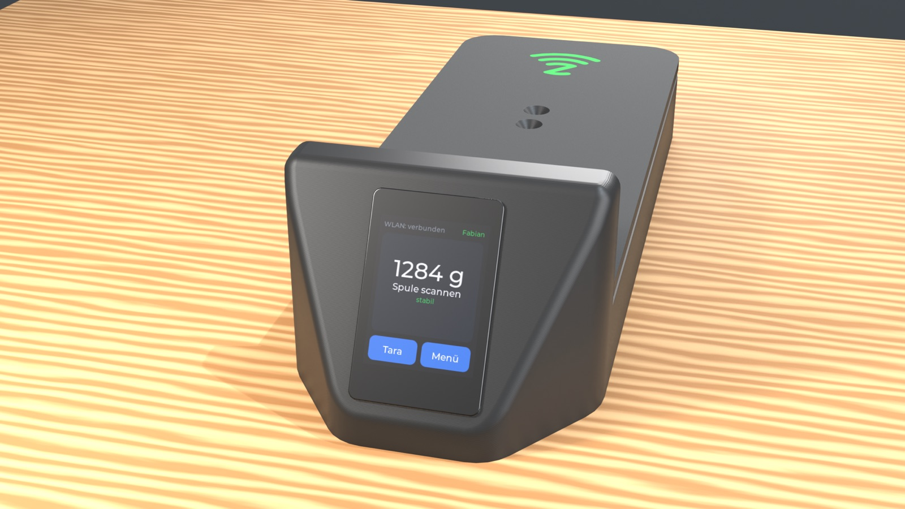

# Filament Scale

English · [Deutsch](#filamentwaage) · [Website](https://drache055.github.io/filament-scale/) · [Build guide](https://drache055.github.io/filament-scale/bauen.html)



A filament scale built on the ESP32-S3. It reads the spool and its storage box via NFC, weighs the spool inside the box and writes the remaining weight and the box as location to [Spoolman](https://github.com/Donkie/Spoolman).

## How it works

1. Hold the spool to the scan zone. The scale looks it up in Spoolman.
2. Put the storage box (with its own NFC tag) on the scale. Weight W1 is stored.
3. Put the spool into the box. Weight W2 is stored.
4. Confirm. Remaining weight and location go to Spoolman.

The box weight never has to be known. Example from the device screens:

| | |
|---|---:|
| W2, box with spool | 1254 g |
| − W1, box alone | 412 g |
| − empty spool (from Spoolman) | 250 g |
| **= remaining weight** | **592 g** |

## Features

- NFC tags NTAG215/216 in OpenSpool format; spool, box and user tags can be written on the device
- Uses the native NFC tags of Spoolman 0.27; unknown spools are linked by picking them from the Spoolman list
- Offline queue: up to 100 updates are kept in flash and sent when Spoolman is reachable again
- Users sign in with their own tag and are recorded as spool owner; settings are admin only
- Web interface for calibration, users, filament catalog, Spoolman, Wi-Fi, log and system settings
- Wi-Fi setup through a hotspot with captive portal, firmware updates over Wi-Fi (OTA)
- German and English, language per user

## Hardware

| Part | Details |
|---|---|
| Board | Waveshare ESP32-S3-Touch-LCD-2 (16 MB flash, 8 MB PSRAM, 240×320 touch display) |
| Load cell | 5 kg bar load cell |
| ADC | HX711, powered with 3.3 V |
| NFC | PN532 in SPI mode |
| Tags | NTAG215 or NTAG216 |
| Enclosure | 3D printed, steel ballast in the base |

Pinout: [`firmware/include/pins.h`](firmware/include/pins.h). Wiring and mechanics: [build guide](https://drache055.github.io/filament-scale/bauen.html).

## Getting started

**Without a toolchain:** use the [web flasher](https://drache055.github.io/filament-scale/bauen.html#webflash) in Chrome or Edge on a computer.

**With PlatformIO:**

```bash
git clone https://github.com/Drache055/filament-scale.git
cd filament-scale/firmware
cp include/secrets.h.example include/secrets.h   # Spoolman URL, Wi-Fi optional
pio run -e waage -t upload                       # first flash over USB
pio run -e waage -t uploadfs                     # theme data
```

After that, updates go over Wi-Fi. Without Wi-Fi credentials the scale opens the hotspot `Filamentwaage-Setup`.

Unit tests run on the host without hardware: `cd firmware && pio test -e native`

Default login: admin password `Filament`, device PIN `1234`. Change both after the first start.

## Repository

```
firmware/   PlatformIO project (ESP32-S3, Arduino, LVGL 9)
docs/       Website (GitHub Pages) and web flasher
```

Development notes: [`firmware/CLAUDE.md`](firmware/CLAUDE.md) (German).

## Status

The firmware builds and the logic is covered by unit tests. The full weighing flow with a real scale, box tag and Spoolman has not been fully tested on the device yet. Feedback and issues are welcome.

## License

[GPL-3.0](LICENSE). You may use, modify and redistribute the firmware, privately and commercially. If you distribute it, modified or not, or ship it in a product, you must publish the complete source code under GPL-3.0. A different commercial license is available on request.

The bundled libraries (LVGL, LovyanGFX, HX711, Adafruit PN532, ArduinoJson) keep their own licenses. 3D files and documentation have no separate license yet.

---

<a id="filamentwaage"></a>

# Filamentwaage

Eine Waage auf Basis des ESP32-S3. Sie liest Spule und Lagerbox per NFC, wiegt die Spule in ihrer Box und trägt Restgewicht und Lagerort in [Spoolman](https://github.com/Donkie/Spoolman) ein. Auf dem Gerät und auf der Webseite gibt es Deutsch und Englisch.

## Ablauf

1. Spule an die Scan-Zone halten. Die Waage sucht sie in Spoolman.
2. Lagerbox (mit eigenem NFC-Tag) auf die Waage stellen. Gewicht W1 wird gespeichert.
3. Spule in die Box stellen. Gewicht W2 wird gespeichert.
4. Bestätigen. Restgewicht und Lagerort gehen an Spoolman.

Das Gewicht der Box muss niemand kennen: Rest = (W2 − W1) − Leerspule, im Beispiel (1254 g − 412 g) − 250 g = 592 g.

## Funktionen

- NFC-Tags NTAG215/216 im OpenSpool-Format; Spulen-, Box- und Benutzer-Tags lassen sich am Gerät beschreiben
- Nutzt die NFC-Tags von Spoolman 0.27; unbekannte Spulen wählt man aus der Spoolman-Liste, danach ist der Tag verknüpft
- Offline-Warteschlange: bis zu 100 Updates bleiben im Flash und werden gesendet, sobald Spoolman erreichbar ist
- Benutzer melden sich mit ihrem Tag an und werden als Besitzer eingetragen; Einstellungen nur für den Admin
- Weboberfläche für Kalibrierung, Benutzer, Filament-Katalog, Spoolman, WLAN, Log und System
- WLAN-Einrichtung über Hotspot mit Captive Portal, Firmware-Updates per WLAN (OTA)

## Schnellstart

**Ohne Entwicklungsumgebung:** [Web-Flasher](https://drache055.github.io/filament-scale/bauen.html#webflash) in Chrome oder Edge am Computer.

**Mit PlatformIO:**

```bash
git clone https://github.com/Drache055/filament-scale.git
cd filament-scale/firmware
cp include/secrets.h.example include/secrets.h   # Spoolman-URL, WLAN optional
pio run -e waage -t upload                       # erstes Flashen per USB
pio run -e waage -t uploadfs                     # Theme-Daten
```

Danach geht alles per WLAN. Ohne WLAN-Daten startet das Gerät den Hotspot `Filamentwaage-Setup`.

Tests auf dem Rechner (ohne Hardware): `cd firmware && pio test -e native`

Standard-Zugang: Admin-Passwort `Filament`, Geräte-PIN `1234`. Beides nach dem ersten Start ändern.

Teileliste, Verdrahtung und Mechanik stehen in der [Bauanleitung](https://drache055.github.io/filament-scale/bauen.html), die Bedienung in der [Anleitung](https://drache055.github.io/filament-scale/anleitung.html).

## Stand

Die Firmware baut, die Logik ist mit Unit-Tests abgedeckt. Der ganze Wiegeablauf mit echter Waage, Box-Tag und Spoolman ist am Gerät noch nicht vollständig geprüft.

## Lizenz

[GPL-3.0](LICENSE). Du darfst die Firmware privat und kommerziell nutzen, ändern und weitergeben. Wer sie (auch verändert) weitergibt oder in einem Produkt verkauft, muss den vollständigen Quellcode unter der GPL-3.0 offenlegen. Eine abweichende kommerzielle Lizenz gibt es auf Anfrage.
