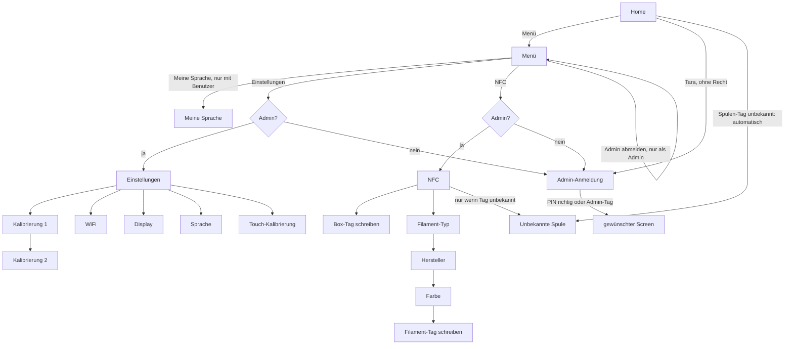

# Menüführung der Filamentwaage (für die Animation)

Display: 240×320 px, Hochformat, Single-Touch. Die Dateinamen beziehen sich auf `1x/` bzw. `4x/` in diesem Ordner.
Die Waage hat **keine Übergangsanimation**: jeder Wechsel ist ein harter Schnitt (neuer Screen ersetzt den alten sofort).
Wer weiche Übergänge möchte, erfindet sie in der Animation; am Gerät gibt es sie nicht.

## Grundaufbau

- **Header** (alle Screens außer Home, Touch-Kalibrierung): links Zurück-Taste `<` (52×52 px), rechts daneben der Titel. Die Taste führt immer eine Ebene zurück (siehe Spalte „Zurück“ unten).
- **Buttons** sind blau, 52 px hoch, meist volle Breite. Reihen mit `-5 -1 +1 +5` teilen sich die Breite.
- **Home** hat keine Zurück-Taste. Unten: [Tara] [Menü].
- Beim Antippen wird der Button dunkler (gedrückt), dann erfolgt der Wechsel.

## Übersicht (Mermaid)

## Screens im Einzelnen

| Nr. | Screen (Bild) | Öffnet über | Elemente → Ziel | Zurück (`<`) |
|---|---|---|---|---|
| 1–5 | **Home** (`01`–`05`, `29_en_home`) | Start; Zurück aus Menü; Ende von „Zuordnen“ | **Tara** → Tara ausführen (bleibt auf Home; ohne Recht → Admin-Anmeldung). **Menü** → Menü. Tippen auf den Namen oben rechts (Benutzer/Admin) → abmelden, bleibt auf Home | – |
| 6, 7, 10 | **Menü** (`06_menue`, `07_menue_benutzer`, `10_menue_admin`) | Home → Menü | **Meine Sprache** (nur wenn Benutzer angemeldet) → Meine Sprache. **Einstellungen** → Admin-Prüfung → Einstellungen. **NFC** → Admin-Prüfung → NFC. **Admin abmelden** (nur als Admin) → Menü neu aufgebaut, Button verschwindet | Home |
| 8 | **Meine Sprache** (`08`) | Menü | **Deutsch / English** → Sprache sofort gewechselt, Screen wird neu aufgebaut (Häkchen wandert, Texte ändern sich), bleibt hier | Menü |
| 9 | **Admin-Anmeldung** (`09`) | Admin-Prüfung bei Einstellungen / NFC; Tara ohne Recht | Ziffernblock: Ziffern erscheinen als Punkte im Feld oben, `<` löscht eine, ✓ bestätigt. Richtige PIN **oder** aufgelegter Admin-Tag → springt direkt zum gewünschten Screen. Falsche PIN → rote Meldung unter dem Feld, Feld leert sich | Home |
| 11 | **Einstellungen** (`11`) | Menü (nur mit Admin) | **Kalibrierung**, **WiFi**, **Display**, **Sprache**, **Touch-Kalibrierung** → jeweiliger Screen | Menü |
| 12, 13 | **WiFi** (`12_wlan`, `13_wlan_getrennt`) | Einstellungen | Nur Anzeige (Status, SSID, IP, Signal, Qualität, Spoolman). Aktualisiert sich jede Sekunde, Farben grün/gelb/rot. Inhalt länger als Screen → scrollbar | Einstellungen |
| 14 | **Display** (`14`) | Einstellungen | `-5 -1 +1 +5` ändern den Wert live (Hinweis „nicht gespeichert“, gelb). **Speichern** → Hinweis „gespeichert“, grün. **Standard** → Standardwert | Einstellungen |
| 15 | **Sprache** (`15`) | Einstellungen | wie „Meine Sprache“, aber für die Gerätesprache | Einstellungen |
| 16 | **Touch-Kalibrierung** (`16`) | Einstellungen | Kein Header. Vier Fadenkreuze erscheinen nacheinander (links oben → rechts oben → links unten → rechts unten), Text in der Mitte „Fadenkreuz berühren“. Nach vier Tipps: Fadenkreuze weg, grüner Text „Gespeichert“, Zurück-Taste erscheint in der Mitte. Misslingt es, beginnt es von vorn mit roter Meldung | erst nach Fertigstellung: Einstellungen |
| 17 | **Kalibrierung 1** (`17`) | Einstellungen | Hinweis „Waage leeren, dann Tara“, Rohwert live. **Tara & weiter** → Kalibrierung 2 | Einstellungen |
| 18 | **Kalibrierung 2** (`18`) | Kalibrierung 1 | Referenzgewicht (Startwert 100 g) mit `-50 -10 +10 +50`. **Kalibrieren** → Ergebnis erscheint in der kleinen Zeile („Kalibriert“, grün), bleibt auf dem Screen | Einstellungen |
| 19–21 | **NFC** (`19_nfc_bereit`, `20_nfc_spule_erkannt`, `21_nfc_spule_unbekannt`) | Menü (nur mit Admin) | Karte oben zeigt live den aufliegenden Tag: *bereit* (grün) → *Elegoo PLA + UID + Spoolman-Zeile* (grün) oder *„Nicht in Spoolman“* (gelb). **Box** → Box-Tag schreiben. **Filament** → Filament-Typ. **Spule zuordnen** erscheint **nur** bei unbekanntem Tag (dritter Button, unter Filament) → Unbekannte Spule | Menü |
| 22, 23 | **Box-Tag schreiben** (`22`, `23`) | NFC → Box | `-5 -1 +1 +5` ändern die Nummer (`BOX-03`). **Schreiben** → Text „Tag auflegen“ (gelb) → „Schreibe…“ → „Geschrieben“ (grün, `23`). Fehler in Rot | NFC |
| 24 | **Filament-Typ** (`24`) | NFC → Filament | Liste (PLA, ABS, PETG …), Tipp → Hersteller | NFC |
| 25 | **Hersteller** (`25`) | Filament-Typ | Liste, Tipp → Farbe | Filament-Typ |
| 26 | **Farbe** (`26`) | Hersteller | Liste mit Farbfeld links im Button, Tipp → Filament-Tag schreiben | Hersteller |
| 27 | **Filament-Tag schreiben** (`27`) | Farbe | Zusammenfassung (Typ, Hersteller, Temperaturen, Farbname, Farbfeld oben rechts). **Schreiben** → wie Box-Tag: „Tag auflegen“ → „Schreibe…“ → „Geschrieben“ | Farbe |
| 28 | **Unbekannte Spule** (`28_spule_zuordnen`) | automatisch auf Home, sobald ein Spulen-Tag aufliegt, den Spoolman nicht kennt; oder NFC → Spule zuordnen | Erst „Lade …“, dann scrollbare Liste der Spoolman-Spulen („#40 Elegoo PLA, 732 g“). Tipp auf Eintrag → Liste verschwindet, Statustext wechselt „Verknüpfe…“ → „Tag auflegen“ (gelb) → „Schreibe…“ → „Spule zugeordnet“ (grün). Fehler rot | Home |
| 29, 30 | **Englisch** (`29_en_home`, `30_en_menu`) | Sprache umgestellt | gleiche Screens, nur Texte englisch | – |

## Hinweise für die Animation

- **Typische Wege:** Home → Menü → Einstellungen → Kalibrierung 1 → Kalibrierung 2; Home → Menü → NFC → Filament → Typ → Hersteller → Farbe → Schreiben; Home → Menü → NFC → Box → Schreiben.
- **Admin-Hürde:** Einstellungen und NFC zeigen bei nicht angemeldetem Admin zuerst die Admin-Anmeldung (`09`). Ist der Admin schon angemeldet, entfällt sie. Für eine kurze Animation darf man sie weglassen, dann Menü → Einstellungen direkt zeigen (Bild `10_menue_admin` als Ausgangslage).
- **Home zeigt immer das Live-Gewicht** (große Zahl). Für Animationen: Zahl kann hochzählen, z. B. 0 g → 1284 g, darunter „stabil“ (grün). Weitere Zustände: `03` Überlast (rot, Hinweis „Ausstehende Updates“), `04` nicht kalibriert, `05` kein Sensor.
- **Statuswechsel auf Schreiben-Screens** laufen im Text, nicht durch neue Screens: Gelb (Tag auflegen / Schreibe…) → Grün (Geschrieben) oder Rot (Fehler). Dazu ein Tag an den PN532 halten (Position siehe CLAUDE.md, Mechanik).
- **Scrollen:** WiFi, NFC (bei langer Tag-Info) und alle Listen (Typ, Hersteller, Farbe, Spulen) lassen sich mit dem Finger vertikal scrollen.
- **Sprache:** Alle Bilder sind deutsch, außer `29`/`30` (englisch). Der Wechsel in „Sprache“ baut den Screen sofort neu auf, ohne Übergang.
- Die Beispielwerte (1284 g, Elegoo PLA, „Fabian“, „Heimnetz“) sind erfunden und frei austauschbar. Neue Bilder mit anderen Werten erzeugt `tools/screenshots/build.sh`.

## Bilder für den Werbeclip (31–37)

Erzeugt mit `tools/screenshots/build.sh` (Block „Werbeclip“ am Ende von `main.cpp`). Alle deutsch, Benutzer „Fabian“ angemeldet (grün oben rechts). Beispiel: **Blaues PLA** (Tag-Farbe `1E64FF`), Spule wiegt **842 g**, Box **412 g**, Tara beseitigt **3 g** Drift.

| Bild | Zeigt | Szene im Clip |
|---|---|---|
| `31_clip_home_drift_3g` | Home, leere Waage zeigt „3 g“ (stabil) | Vor dem Wiegen: Anzeige driftet |
| `32_clip_home_nach_tara` | Home, „0 g“ | Nach Tipp auf [Tara] |
| `33_clip_home_box_412g` | Home, „412 g“ | Box (Müslibox) steht auf der Platte |
| `34_clip_home_box_mit_spule_1254g` | Home, „1254 g“ | Spule in der Box (412 + 842) |
| `35_clip_home_spule_entnommen` | Home, „412 g“ | Spule wieder herausgenommen |
| `36_clip_home_spule_842g` | Home, „842 g“ | Blaue Spule allein auf der Platte |
| `37_clip_nfc_blaues_pla` | Menü → NFC, Spule erkannt, Spoolman-Zeile (592 g, Box 03, Fabian) | Spulen-Tag wird gelesen |

Ablauf: `31` → Tipp auf Tara → `32` → `33` → `34` → `35`/`36` (harte Schnitte, Zahl darf dazwischen hochzählen).
Hinweis: Die Waage hat noch **keine** Screens für „Box auflegen“, „Spule einstellen“, „Bestätigen“ oder „Ergebnis“ (kein Zustandsautomat in `src/app/`). Am Gerät sieht man in dem Ablauf nur Home mit dem Live-Gewicht. Die Rechnung (1254 − 412 = 842 g) und das Speichern in Spoolman müssen als Einblendung im Clip stehen.

## Wiegeablauf (38–46)

Seit Firmware-Abschnitt 16 gibt es die Screens des Wiegeablaufs. Beispiel wie im Clip: Elegoo PLA blau, Box 03 (412 g), Spule 842 g, Leerspule 250 g, Rest 592 g.

| Bild | Zustand | Anzeige |
|---|---|---|
| `38_ablauf_1_spule_erkannt` | Spule erkannt | Farbfeld blau, „Elegoo PLA“, „Letzter Rest: 592 g“, Hinweis „Waage leeren“ solange nicht leer |
| `39_ablauf_2_box_auflegen_leer` | Box auflegen | „0 g“, „Box-Tag wird gesucht ...“ |
| `40_ablauf_3_box_erkannt` | Box auflegen | „412 g“, „Box: Box 03“ (grün) |
| `41_ablauf_4_spule_einstellen_leer` | Spule in die Box | „0 g“ (relativ zu W1), „Box: Box 03, 412 g“ |
| `42_ablauf_5_spule_einstellen_842g` | Spule in die Box | „842 g“ (Gesamtanzeige 1254 g minus W1) |
| `43_ablauf_6_bestaetigen` | Bestätigen | Box, Spule, „Restgewicht 592 g“, [Speichern] [✕] |
| `44_ablauf_7_speichern` | Speichern | „Speichere ...“ |
| `45_ablauf_8_gespeichert` | Fertig | „Gespeichert“ (grün), „592 g“, „Box entnehmen“, [Fertig] |
| `46_ablauf_9_home_nach_ende` | Home | „0 g“ nach Entnehmen der Box |

Alle Wechsel sind harte Schnitte. Zu jedem Screen unten: [Abbrechen] (außer Speichern). Die Zahlen oben zeigen den Live-Wert; in `43` wurden 842 g (= 1254 − 412) abzüglich Leerspule 250 g zu 592 g.

## Einfache Waage (Betriebsart „Einfache Waage“, Rolle „Nur wiegen“)

Beispiel: Spule 1092 g gesamt (Leerspule 250 g → Filament 842 g), Box 412 g mit Spule 842 g (→ Filament 592 g).

| Bild | Zustand | Anzeige |
|---|---|---|
| `72_einfach_1_home` | Home | „Einfache Waage“, [Filament wiegen] [Tara] [Menü], keine Anmeldung |
| `73_einfach_2_auswahl` | Auswahl | „Was kommt auf die Waage?“, [Nur Spule] [Box + Spule] [Zurück] |
| `74_einfach_3_nur_spule_1092g` | Spule auflegen | „Filament 842 g“, „Spule gesamt: 1092 g“, Leerspule −10/+10, [Fertig] |
| `75_einfach_4_box_auflegen` | Box auflegen | „412 g“ gedimmt (nicht stabil), [Box tarieren] gesperrt, [✕] |
| `76_einfach_5_box_stabil` | Box auflegen | „412 g“, [Box tarieren] aktiv |
| `77_einfach_6_box_und_spule_1254g` | Spule in die Box | „Filament 592 g“, „Spule 842 g • Box 412 g“ |
| `78_einfach_7_waage_leeren` | Waage leeren | Start mit Gewicht auf der Waage, [Abbrechen] |
| `79_home_nur_wiegen` | Home (smarte Waage) | Benutzer mit „Nur wiegen“ angemeldet: [Filament wiegen], kein „Spule scannen“ |
